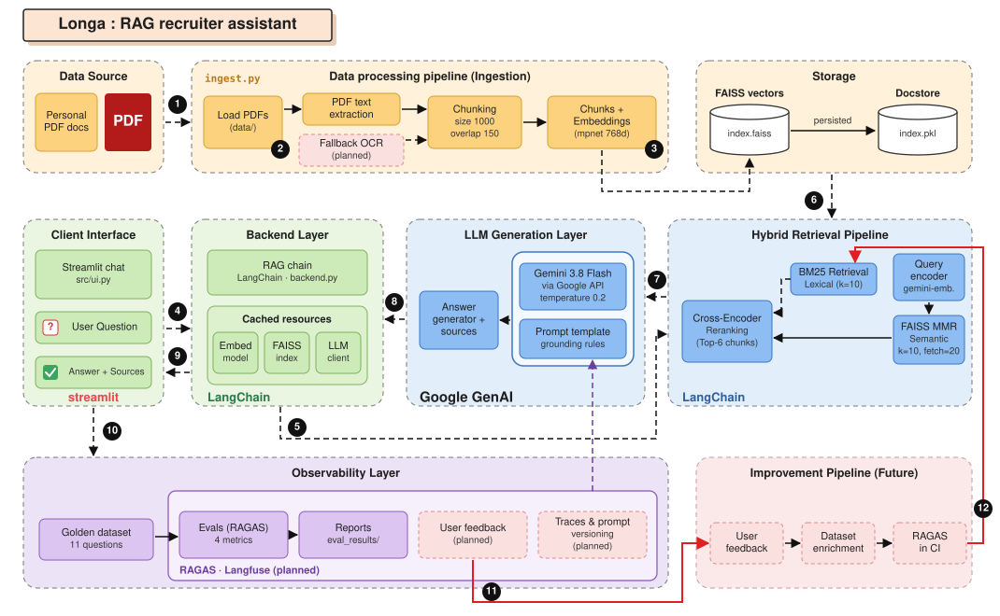

# Longa RAG-based Assistant for Graduate Employment

> **Longa** est l'assistant IA de Loïc NGASSA, conçu pour répondre aux questions des recruteurs à partir de ses documents personnels. Il exploite un système de **recherche hybride** combinant une base vectorielle FAISS et une recherche par mots-clés BM25, affinée par un **reranker cross-encoder**. Les réponses sont générées avec précision via le modèle **Google Gemini 3.8 Flash**.

---

## Système design



```
data/                        ← Documents PDF sources
    ↓  ingest.py
faiss_index/                 ← Base vectorielle persistante 
    ↓  src/backend.py
Hybrid Retriever             ← Recherche hybride : MMR + BM25
    ↓
Cross-Encoder Reranker       ← Tri des candidats
    ↓
Google Gemini 3.8 Flash      ← LLM de génération via API Google
    ↓  src/ui.py
Interface Streamlit          ← Chat interactif avec affichage des sources
```

### Flux RAG complet

```
Question utilisateur
      ↓
[Recherche Hybride]
  ├── [Gemini Embedding] → encodage vecteur → [FAISS + MMR] → Vector Docs
  └── [BM25 Tokenizer] → mots-clés exacts → [BM25] → Lexical Docs
      ↓
[Dédoublonnage] → Union des documents uniques
      ↓
[Cross-Encoder] → ms-marco-MiniLM-L-6-v2 → Reranking par pertinence
      ↓
Sélection du top-6 documents
      ↓
[Prompt Longa] → contexte injecté + règles strictes anti-hallucination
      ↓
[Gemini-3.8-Flash] → réponse générée précise
      ↓
Affichage + sources
```

---

## Stack technique

| Composant | Technologie |
|-----------|-------------|
| Interface | Streamlit 1.63+ |
| LLM Génératif | `gemini-3.8-flash` via API Google |
| Embeddings | `models/gemini-embedding-001` |
| Reranker | `cross-encoder/mmarco-mMiniLMv2-L12-H384-v1` via `sentence-transformers` |
| Base documentaires | MMR + BM25 |
| Orchestration | LangChain |
| Évaluation | RAGAS 0.2.x  |
| Gestion des dépendances | `uv` |

---

## Structure du projet

```
RAGE/
├── data/                        # PDFs sources
├── faiss_index/                 # Index vectoriel généré
│   ├── index.faiss
│   └── index.pkl
├── src/
│   ├── __init__.py
│   ├── backend.py               # Reranker, Recherche Hybride, chaîne RAG
│   └── ui.py                    # Interface Streamlit
├── evaluation/
│   ├── __init__.py
│   └── evaluate.py              # Pipeline d'évaluation RAGAS
├── eval_results/                # Rapports générés après évaluation
├── golden_dataset.json          # 11 questions de référence pour l'évaluation
├── ingest.py                    # Pipeline d'ingestion des PDFs → FAISS
├── app.py                       # Point d'entrée Streamlit
├── pyproject.toml
└── .env                         
```

---

## Installation

### Prérequis

- Python 3.13+
- [`uv`](https://docs.astral.sh/uv/) installé
- Une clé `GOOGLE_API_KEY` (et optionnellement `GROQ_API_KEY` pour l'évaluation)

### Mise en place

```bash
# 1. Cloner le projet
git clone <url-du-repo>
cd RAGE

# 2. Installer les dépendances
uv sync

# 3. Configurer les variables d'environnement
cp .env.example .env
# Renseigner GOOGLE_API_KEY dans .env
```

---

## Utilisation

### 1. Ingestion des documents

Placer les PDFs dans le dossier `data/`, puis lancer :

```bash
uv run python ingest.py
```

> À effectuer **une seule fois**, ou après ajout/modification de documents.  
> L'index FAISS est ensuite persisté sur disque et ne nécessite plus de ré-ingestion. (L'index lexical BM25 est recréé en RAM à la volée depuis l'index FAISS).

### 2. Lancer l'assistant

```bash
uv run streamlit run app.py
```

L'interface est accessible sur `http://localhost:8501`. Au premier chargement de la session, le modèle de Reranking Cross-Encoder sera téléchargé et mis en cache (environ 130 Mo).

---

## Évaluation avec RAGAS

Le pipeline d'évaluation mesure la qualité du système RAG sur un ensemble de questions de référence.
*Note: Le pipeline d'évaluation charge directement la chaîne de production `backend.py` pour tester le vrai retriever utilisé par les recruteurs.*

```bash
uv run python -m evaluation.evaluate \
    --dataset golden_dataset.json \
    --faiss-index ./faiss_index
```

Les résultats sont sauvegardés dans `eval_results/`.

### Métriques évaluées

| Métrique | Description |
|----------|-------------|
| `faithfulness` | La réponse est-elle fidèle au contexte récupéré ? |
| `answer_relevancy` | La réponse répond-elle à la question posée ? |
| `context_precision` | Les passages récupérés sont-ils pertinents ? |
| `context_recall` | Le contexte couvre-t-il ce qui est nécessaire pour répondre ? |

---

## Choix de conception

### Recherche Hybride et Reranking (Cross-Encoder)

Pour optimiser la récupération documentaire, le RAG combine :
1. **Recherche Vectorielle (FAISS + MMR) :** Trouve le sens profond de la question.
2. **Recherche Lexicale (BM25) :** Trouve les mots-clés exacts traités via tokénisation spécialisée (minuscules, sans accents).
Les documents sont ensuite fusionnés et soumis au **Cross-Encoder MMarco**, qui ré-évalue précisément chaque combinaison [Question-Document] afin de ne fournir que le contenu le plus percutant au LLM génératif.

### Mise en cache mémoire optimisée

Le modèle d'embedding et le modèle de cross-encoder (tous les deux volumineux) sont entourés d'un décorateur `@st.cache_resource`. Streamlit ne les charge dans la RAM qu'une seule fois au lancement du serveur local.

### Prompt anti-hallucination strict

Le prompt système interdit explicitement tout vocabulaire spéculatif ("probablement", "il semble", etc.) et impose une réponse standard lorsqu'une information est absente des documents.

---

## Limitations connues

- **Temps de premier démarrage :** Le modèle Cross-Encoder doit être téléchargé et chargé en RAM lors de la première interaction RAG.
- **Mémoire RAM :** Le modèle Cross-Encoder et le modèle d'embeddings consomment de la mémoire au runtime.
- **Périmètre :** limité aux informations présentes dans les documents fournis, toute question hors périmètre reçoit une réponse d'absence d'information.